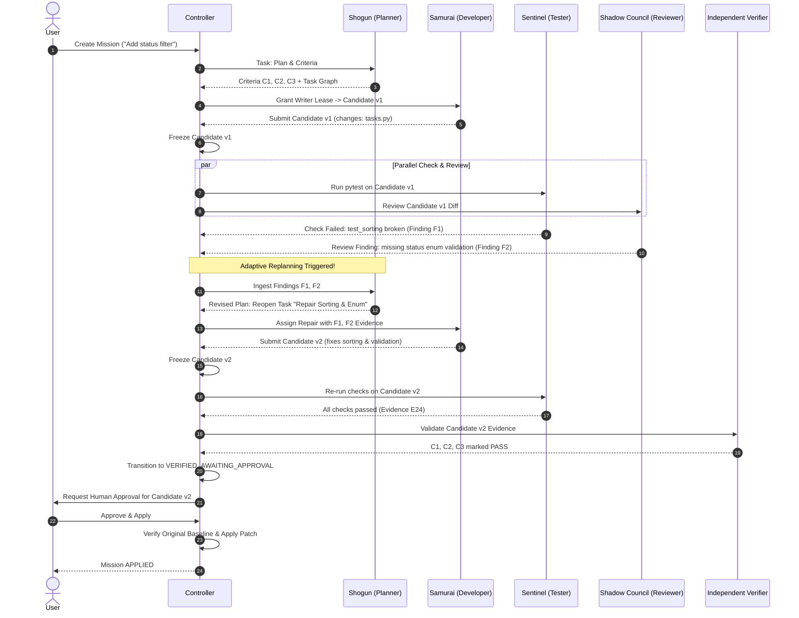

# DevPilot / KAGE AI Backend — Complete Implementation Specification

> **PECATHON 2026 · PS-001 · The Mystic Mikado’s Autonomous AI Engineering Guild**  
> **System Name:** DevPilot / KAGE AI Backend  
> **Status:** Authoritative Backend Specification & Implementation Blueprint  
> **Aligned with:** `DEVPILOT_MASTER_PLAN.md`, `design .md`, and PS-001 Requirements  

---

## 1. Executive Summary & Core Mission

DevPilot / KAGE AI is a local backend service that accepts natural-language software engineering requests against an existing small local repository and coordinates an autonomous guild of specialized agents:

1. **Planner / Shogun (The Shogun’s Council):** Analyzes the request, inspects repository structure and conventions, establishes testable acceptance criteria, builds a dependency-aware task graph, and adapts the plan when findings arrive.
2. **Developer / Samurai (The Samurai Forge):** Employs at least three distinct controlled tool categories (read/search, targeted patch, diff, approved diagnostics) to implement changes in a disposable workspace while preserving existing style.
3. **Tester / Sentinel (The Sentinel Dojo):** Runs approved check profiles against an immutable, frozen candidate snapshot, records exact exit codes, execution times, stdout/stderr, and sends structured failure findings back to the guild.
4. **Reviewer / Shadow Council (The Shadow Council):** Inspects candidate diffs for correctness, conventions, regressions, exposed secrets, unsafe operations, injection risks, and test weakening.
5. **Independent Verifier (Deterministic Process):** An authoritative, deterministic validation engine that evaluates execution evidence against acceptance criteria for the exact candidate fingerprint. It is not an LLM persona.

### Core Lifecycle Flow
```text
Connect Repository 
    ──► Preflight & Snapshot 
    ──► Baseline Checks 
    ──► Plan & Criteria 
    ──► User Authorization 
    ──► Samurai Implementation (Disposable Workspace) 
    ──► Freeze Candidate v1 
    ──► Sentinel Checks & Shadow Council Review 
    ──► Adaptive Routing (Failure/Finding ──► Plan Revision ──► Candidate v2) 
    ──► Independent Deterministic Verification 
    ──► Candidate-Specific Human Approval Gate 
    ──► Validated Patch Application or Export
```

### Invariants
1. **Model Proposes, Trusted Application Code Validates:** Models never execute arbitrary shell commands and never directly alter mission status to `VERIFIED`.
2. **Single Writer Lease:** Multiple tasks may inspect the repository or frozen candidates in parallel, but at most one writer (Samurai agent) holds the workspace write lease at any time.
3. **Candidate-Bound Evidence:** All test runs, review findings, and verification decisions are cryptographically or fingerprint-bound to an immutable candidate snapshot. An edit produces a new candidate and invalidates obsolete evidence.
4. **Strict Isolation Prerequisite:** Repository checks run only inside restricted containers. If container isolation is unavailable, execution is blocked with clear remediation rather than falling back to unisolated host execution.
5. **No Blind Side-Effects:** Never re-run non-idempotent operations blindly. Human approval is strictly candidate-specific and requires clean original-workspace state validation before application.

---

## 2. Technical Stack & Workspace Environment

| Layer | Selection | Justification & Environment Binding |
| :--- | :--- | :--- |
| **Runtime** | Python 3.12.10 | Installed and verified in workspace environment. |
| **HTTP Framework** | FastAPI + Uvicorn | Async performance, automated OpenAPI generation, SSE streaming. |
| **Data Validation** | Pydantic v2 | Strict serialization, request/response validation, and settings management. |
| **Persistence** | SQLite (`aiosqlite` / `sqlite3`) | Single-file zero-config durable state with WAL mode, transactions, and foreign keys. |
| **Artifact Store** | Local filesystem (`storage/artifacts/`) | Content-addressed bounded file artifacts outside repository workspaces. |
| **Live Streaming** | Server-Sent Events (SSE) | Monotonic sequence IDs, event replay via `Last-Event-ID`. |
| **Model Integration** | Unified `ModelAdapter` | Anthropic-compatible hosted gateway via `ANTHROPIC_BASE_URL` (`https://api.argmin.run/v1`) using server-side keys. |
| **Isolation** | Restricted Linux Containers | Docker engine with non-root user, read-only rootfs, dropped capabilities, no network. |
| **Frontend Integration** | REST + SSE | Consumed directly by KAGE AI UI in `frontend/`. |

---

## 3. System Architecture & Trust Boundaries

```
┌───────────────────────────────────────────────────────────────┐
│                    Browser / KAGE AI UI                       │
└───────────────▲───────────────────────────────┬───────────────┘
                │ SSE Stream                    │ HTTP REST
                │ (Reconnection & Replay)       │ (Path, Auth, Decisions)
┌───────────────┴───────────────────────────────▼───────────────┐
│                    DevPilot FastAPI Service                   │
│                                                               │
│  ┌─────────────────────────────────────────────────────────┐  │
│  │                   Mission Controller                    │  │
│  │  - State Machine & Transitions                          │  │
│  │  - Adaptive Scheduler & Writer Lease                    │  │
│  │  - Budget & Timeout Watchdog                            │  │
│  └──────┬──────────────┬──────────────┬──────────────┬─────┘  │
│         │              │              │              │        │
│  ┌──────▼──────┐┌──────▼──────┐┌──────▼──────┐┌──────▼──────┐ │
│  │   SHOGUN    ││   SAMURAI   ││  SENTINEL   ││SHADOW COUNC.│ │
│  │  (Planner)  ││ (Developer) ││  (Tester)   ││ (Reviewer)  │ │
│  └──────┬──────┘└──────┬──────┘└──────┬──────┘└──────┬──────┘ │
│         │              │              │              │        │
│         └──────────────┼──────────────┼──────────────┘        │
│                        ▼              ▼                       │
│             ┌──────────────────────────────────┐              │
│             │     Unified Model Adapter        │              │
│             │  (Structured Tools, Rate Limits) │              │
│             └─────────────────┬────────────────┘              │
│                               ▼                               │
│                  Hosted Model (Claude 3.5)                    │
│                                                               │
│  ┌─────────────────────────────────────────────────────────┐  │
│  │                Validated Tool Gateway                   │  │
│  │  - Path Traversal Blockers & Canonicalization           │  │
│  │  - list_files, search_text, read_file                   │  │
│  │  - apply_patch (with Writer Lease check)                │  │
│  │  - read_diff & run_check profile validation             │  │
│  └──────┬──────────────────────────────┬───────────────────┘  │
│         │                              │                      │
│  ┌──────▼──────────────┐        ┌──────▼───────────────────┐  │
│  │  Workspace Manager  │        │   Execution Manager      │  │
│  │  - Baseline snapshot│        │   - Restricted Docker    │  │
│  │  - Disposable copy  │        │   - Read-only candidate  │  │
│  │  - Candidate freeze │        │   - Process limits & red.│  │
│  └─────────────────────┘        └──────────────┬───────────┘  │
│                                                ▼              │
│                                 ┌──────────────────────────┐  │
│                                 │   Independent Verifier   │  │
│                                 │ (Deterministic Evidence) │  │
│                                 └──────────────┬───────────┘  │
│                                                ▼              │
│  ┌─────────────────────────────────────────────────────────┐  │
│  │           Durable SQLite & Artifact Store               │  │
│  │  - Missions, Tasks, Messages, Evidence, Approvals       │  │
│  └─────────────────────────────────────────────────────────┘  │
└───────────────────────────────────────────────────────────────┘
```

### Trust Boundary Rules
1. **Untrusted Inputs:** Repository files, git commit messages, test output, diffs, and LLM text are untrusted data. They cannot alter controller state, elevate permissions, or bypass security rules.
2. **Credential Protection:** Model API keys and system secrets remain exclusively on the backend server. They are never injected into containers, returned in HTTP responses, logged, or emitted in SSE streams.
3. **Container Sandboxing:** Repository code (including tests and linters) executes inside restricted Linux containers with no host home mounts, no Docker socket, no network access, and bounded memory/CPU.
4. **Prerequisite Enforcement:** If Docker is unreachable, commands are **never** silently executed on the host. The preflight or execution service flags `BLOCKED` with instructions to start Docker Desktop.

---

## 4. Guild Persona & Coordination Contracts

### A. The Shogun's Council — Planner
- **Inputs:** Natural-language request, repository structure summary, baseline check evidence, review findings, and user clarifications.
- **Allowed Tools:** `list_files`, `search_text`, `read_file`, `request_clarification`, `submit_plan`.
- **Responsibilities:**
  - Performs repository reconnaissance prior to proposing edits.
  - Generates verifiable acceptance criteria.
  - Builds initial task DAG with explicit dependencies.
  - Revises plan and reopens tasks when Sentinel or Shadow Council emits a blocking finding.
- **Restrictions:** Cannot mutate workspace code, run test profiles, or self-certify criteria.

### B. The Samurai Forge — Developer
- **Inputs:** Assigned task, task description, acceptance criteria, target file references, prior failure findings, and reviewer critique.
- **Allowed Tools:** $\ge 3$ distinct tool categories:
  1. *Exploration:* `search_text`, `read_file`, `list_files`.
  2. *Modification:* `apply_patch` (requires active write lease).
  3. *Inspection & Diagnostics:* `read_diff`, `run_diagnostic` (approved static analysis).
- **Responsibilities:**
  - Explores existing code conventions before modifying files.
  - Generates minimal, targeted patches in the disposable workspace.
  - Emits candidate completion handoff (`submit_candidate`).
- **Restrictions:** Never edits the original repository folder. Cannot alter protected test files.

### C. The Sentinel Dojo — Tester
- **Inputs:** Acceptance criteria, baseline test results, frozen candidate ID, and check requests.
- **Allowed Tools:** `read_file`, `run_check`, `report_finding`.
- **Responsibilities:**
  - Runs approved test and build check profiles against the frozen candidate container.
  - Captures exit codes, duration, bounded stdout/stderr, and individual test failures.
  - Categorizes errors: `CODE_FAILURE`, `ENVIRONMENT_ERROR`, `TIMEOUT`, `BASELINE_DEFECT`.
  - Sends structured `FINDING` messages to the Planner and Developer.
- **Restrictions:** Operates exclusively on immutable, frozen candidates. Cannot edit code.

### D. The Shadow Council — Reviewer
- **Inputs:** Mission request, acceptance criteria, candidate diff, test evidence, and static scan results.
- **Allowed Tools:** `read_file`, `read_diff`, `run_security_scan`, `report_finding`.
- **Responsibilities:**
  - Inspects code diff for readability, regressions, and unintended changes.
  - Checks for hardcoded secrets, injection vectors, unsafe subprocess/eval usage, and test weakening.
  - Assigns severity: `INFO`, `LOW`, `MEDIUM`, `HIGH`, `BLOCKING`.
  - Recommends repair or escalates unresolved disagreements.
- **Restrictions:** Agent approval recommendations do not authorize patch application.

### E. Independent Verifier (Deterministic Engine)
- **Role:** Independent automated verification service (not an LLM agent).
- **Responsibilities:**
  - Validates that required checks were executed against the exact candidate fingerprint.
  - Ensures tests did not skip all assertions and produced exit code 0.
  - Maps evidence artifacts to specific acceptance criteria.
  - Marks criteria as `PASS`, `FAIL`, or `NOT_VERIFIED`.

---

## 5. Canonical Data Schemas

All schemas use strict Pydantic v2 models.

### 5.1 Mission State & Lifecycles
```python
class MissionStatus(str, Enum):
    CREATED = "CREATED"
    PREFLIGHT = "PREFLIGHT"
    AWAITING_CLARIFICATION = "AWAITING_CLARIFICATION"
    PLANNING = "PLANNING"
    READY_FOR_AUTHORIZATION = "READY_FOR_AUTHORIZATION"
    RUNNING = "RUNNING"
    CHECKING = "CHECKING"
    REPAIRING = "REPAIRING"
    REVIEWING = "REVIEWING"
    VERIFYING = "VERIFYING"
    VERIFIED_AWAITING_APPROVAL = "VERIFIED_AWAITING_APPROVAL"
    APPLYING = "APPLYING"
    APPLIED = "APPLIED"
    REJECTED = "REJECTED"
    BLOCKED = "BLOCKED"
    FAILED_VERIFICATION = "FAILED_VERIFICATION"
    BUDGET_EXHAUSTED = "BUDGET_EXHAUSTED"
    CANCEL_REQUESTED = "CANCEL_REQUESTED"
    CANCELLED = "CANCELLED"
    INTERRUPTED = "INTERRUPTED"
```

### 5.2 Acceptance Criterion
```python
class CriterionStatus(str, Enum):
    PENDING = "PENDING"
    PASS = "PASS"
    FAIL = "FAIL"
    PARTIAL = "PARTIAL"
    NOT_VERIFIED = "NOT_VERIFIED"
    BLOCKED = "BLOCKED"

class AcceptanceCriterion(BaseModel):
    id: str = Field(default_factory=lambda: f"crit-{uuid4().hex[:8]}")
    mission_id: str
    description: str
    verification_method: str  # e.g., "test_profile:pytest_unit"
    status: CriterionStatus = CriterionStatus.PENDING
    evidence_ids: list[str] = Field(default_factory=list)
    criteria_version: int = 1
```

### 5.3 Task Graph
```python
class TaskStatus(str, Enum):
    PENDING = "PENDING"
    READY = "READY"
    RUNNING = "RUNNING"
    BLOCKED = "BLOCKED"
    DONE = "DONE"
    FAILED = "FAILED"
    CANCELLED = "CANCELLED"

class MissionTask(BaseModel):
    id: str = Field(default_factory=lambda: f"task-{uuid4().hex[:8]}")
    mission_id: str
    title: str
    description: str
    owner_agent: str  # "SHOGUN" | "SAMURAI" | "SENTINEL" | "SHADOW_COUNCIL"
    dependencies: list[str] = Field(default_factory=list)
    status: TaskStatus = TaskStatus.PENDING
    attempt: int = 1
    candidate_id: str | None = None
    result_summary: str | None = None
    evidence_ids: list[str] = Field(default_factory=list)
    created_at: datetime = Field(default_factory=lambda: datetime.now(timezone.utc))
    updated_at: datetime = Field(default_factory=lambda: datetime.now(timezone.utc))
```

### 5.4 Candidate & Workspace Snapshot
```python
class CandidateState(str, Enum):
    MUTABLE = "MUTABLE"
    FROZEN = "FROZEN"
    SUPERSEDED = "SUPERSEDED"
    APPROVED = "APPROVED"
    APPLIED = "APPLIED"
    REJECTED = "REJECTED"

class Candidate(BaseModel):
    id: str = Field(default_factory=lambda: f"cand-{uuid4().hex[:8]}")
    mission_id: str
    parent_candidate_id: str | None = None
    workspace_snapshot_id: str
    content_fingerprint: str  # SHA-256 of workspace tree
    changed_files: list[str] = Field(default_factory=list)
    criteria_version: int = 1
    state: CandidateState = CandidateState.MUTABLE
    ui_badge: str = "PROPOSED"  # "PROPOSED" | "REVIEWING" | "IN_CANDIDATE" | "VERIFIED" | "APPLIED"
    created_at: datetime = Field(default_factory=lambda: datetime.now(timezone.utc))
```

### 5.5 Structured Message & Finding
```python
class MessageType(str, Enum):
    TASK_PROPOSAL = "TASK_PROPOSAL"
    TASK_RESULT = "TASK_RESULT"
    FINDING = "FINDING"
    CLARIFICATION = "CLARIFICATION"
    CHECK_REQUEST = "CHECK_REQUEST"
    BLOCKER = "BLOCKER"
    HANDOFF = "HANDOFF"

class AgentMessage(BaseModel):
    id: str = Field(default_factory=lambda: f"msg-{uuid4().hex[:8]}")
    mission_id: str
    sender: str
    recipient: str
    type: MessageType
    task_id: str | None = None
    candidate_id: str | None = None
    summary: str
    payload: dict[str, Any] = Field(default_factory=dict)
    evidence_ids: list[str] = Field(default_factory=list)
    created_at: datetime = Field(default_factory=lambda: datetime.now(timezone.utc))

class FindingSeverity(str, Enum):
    INFO = "INFO"
    LOW = "LOW"
    MEDIUM = "MEDIUM"
    HIGH = "HIGH"
    BLOCKING = "BLOCKING"

class FindingStatus(str, Enum):
    OPEN = "OPEN"
    IN_PROGRESS = "IN_PROGRESS"
    RESOLVED = "RESOLVED"
    ACCEPTED_WITH_RISK = "ACCEPTED_WITH_RISK"
    REJECTED = "REJECTED"

class Finding(BaseModel):
    id: str = Field(default_factory=lambda: f"find-{uuid4().hex[:8]}")
    mission_id: str
    source_agent: str
    severity: FindingSeverity
    title: str
    description: str
    file_path: str | None = None
    line_start: int | None = None
    line_end: int | None = None
    observed_behavior: str
    expected_behavior: str
    evidence_ids: list[str] = Field(default_factory=list)
    candidate_id: str | None = None
    status: FindingStatus = FindingStatus.OPEN
    resolution_evidence_ids: list[str] = Field(default_factory=list)
    created_at: datetime = Field(default_factory=lambda: datetime.now(timezone.utc))
```

### 5.6 Evidence Artifact
```python
class EvidenceKind(str, Enum):
    TEST = "TEST"
    BUILD = "BUILD"
    LINT = "LINT"
    STATIC_SCAN = "STATIC_SCAN"
    DIFF = "DIFF"
    REVIEW_FINDING = "REVIEW_FINDING"
    BASELINE = "BASELINE"

class Evidence(BaseModel):
    id: str = Field(default_factory=lambda: f"ev-{uuid4().hex[:8]}")
    mission_id: str
    candidate_id: str
    criterion_id: str | None = None
    kind: EvidenceKind
    source: str
    command: list[str] = Field(default_factory=list)
    exit_code: int | None = None
    duration_ms: int = 0
    stdout_artifact_id: str | None = None
    stderr_artifact_id: str | None = None
    fingerprint: str
    metadata: dict[str, Any] = Field(default_factory=dict)
    created_at: datetime = Field(default_factory=lambda: datetime.now(timezone.utc))
```

### 5.7 SSE Mission Event
```python
class MissionEvent(BaseModel):
    sequence: int  # Monotonic per mission (1, 2, 3...)
    mission_id: str
    event_type: str
    source: str
    task_id: str | None = None
    candidate_id: str | None = None
    evidence_ids: list[str] = Field(default_factory=list)
    display_payload: dict[str, Any] = Field(default_factory=dict)
    created_at: datetime = Field(default_factory=lambda: datetime.now(timezone.utc))
```

---

## 6. HTTP REST API Contracts

All endpoints return predictable JSON with standard error envelopes.

### 6.1 Health & Diagnostics
- **`GET /api/health`**
  - Response:
    ```json
    {
      "status": "ok",
      "service": "kage-backend",
      "version": "0.1.0",
      "docker_available": false,
      "model_configured": true,
      "storage_ready": true
    }
    ```
  - Compatible with `classifyHealth` in `frontend/src/mission-draft.js`.

### 6.2 Repositories & Preflight
- **`POST /api/repositories/connect`**
  - Request: `{ "path": "D:/MyDocuments/sample-project" }`
  - Validates folder existence, path traversal rejection, builds inclusion manifest, inspects git state, and checks runtime/Docker status.
  - Response:
    ```json
    {
      "repository_id": "repo-7f8a9b",
      "name": "sample-project",
      "path": "D:/MyDocuments/sample-project",
      "preflight": {
        "status": "READY",
        "detected_profile": "python_pytest",
        "file_count": 18,
        "excluded_count": 42,
        "existing_modifications": false,
        "warnings": [],
        "blockers": []
      }
    }
    ```
- **`GET /api/repositories/{id}/tree`**
  - Returns hierarchical JSON of approved files (excluding `.env`, `.git`, `venv`, etc.).
- **`GET /api/repositories/{id}/file?path={relative_path}`**
  - Returns raw text content for the IDE explorer (capped at 500 KB, strictly path-validated).

### 6.3 Mission Management
- **`POST /api/missions`**
  - Request:
    ```json
    {
      "repository_id": "repo-7f8a9b",
      "request_text": "Add status filtering and reject unsupported statuses.",
      "criteria": [
        "Status filter accepts active and completed",
        "Unsupported status raises 400 Bad Request",
        "Preserve existing task sorting"
      ]
    }
    ```
  - Response: Complete `Mission` object with `id: "miss-..."`, status `PLANNING`.
- **`GET /api/missions/{id}`**
  - Returns full mission state, tasks, criteria, active candidate, budgets, and findings.
- **`POST /api/missions/{id}/clarifications`**
  - Request: `{ "question_id": "...", "answer": "Filter should be case-insensitive." }`
  - Resumes blocked tasks.
- **`POST /api/missions/{id}/cancel`**
  - Halts execution, kills active containers, releases leases, and marks `CANCELLED`.

### 6.4 Live Streaming (SSE)
- **`GET /api/missions/{id}/events`**
  - Headers supported: `Last-Event-ID: {sequence}`.
  - Returns text/event-stream of monotonic `MissionEvent`s. Replays missed events if `Last-Event-ID` is provided.

### 6.5 Candidates, Diffs & Code Viewer
- **`GET /api/missions/{id}/candidates/{cand_id}/diff`**
  - Returns unified diff and structured file-by-file patch metadata.
- **`GET /api/missions/{id}/candidates/{cand_id}/file?path={relative_path}`**
  - Returns file contents as of that candidate snapshot for the IDE editor.
- **`GET /api/missions/{id}/evidence/{evidence_id}`**
  - Returns detailed execution record and bounded stdout/stderr text.

### 6.6 Human Approval & Patch Application
- **`POST /api/missions/{id}/approve`**
  - Request:
    ```json
    {
      "candidate_id": "cand-03",
      "candidate_fingerprint": "a3f5b8...",
      "decision": "APPROVED"
    }
    ```
  - Records candidate-specific approval. Fails with `409 Conflict` if candidate is stale or fingerprint mismatches.
- **`POST /api/missions/{id}/apply`**
  - Request: `{ "candidate_id": "cand-03" }`
  - Validates that:
    1. Candidate is in `APPROVED` state.
    2. Original repository has not changed since preflight (re-checks baseline hashes).
    3. Patch applies cleanly.
  - Applies patch, updates status to `APPLIED`.
- **`POST /api/missions/{id}/reject`**
  - Marks candidate `REJECTED`.
- **`GET /api/missions/{id}/report`**
  - Exports a Markdown/JSON mission summary with full evidence citations.
- **`GET /api/missions/{id}/patch`**
  - Downloads `.patch` file for manual git apply.

---

## 7. Validated Tool Gateway & Security Boundaries

### 7.1 Internal Tools
| Tool Name | Caller | Purpose | Hard Security Enforcement |
| :--- | :--- | :--- | :--- |
| `list_files` | All | Explore directory structure | Restricted to workspace folder; exclusions enforced. |
| `search_text` | All | Grep for strings/regex | Max 50 results; bounded lines; excluded files filtered. |
| `read_file` | All | Inspect source files | Canonicalized relative paths; size cap 500 KB; rejects `..`. |
| `apply_patch` | Samurai | Make targeted edits | Validates active Writer Lease; verifies parent candidate hash. |
| `read_diff` | All | Compare candidate to baseline | Read-only; bounded output. |
| `run_check` | Sentinel | Run pytest / linters | Strict whitelist of check profiles; container isolated only. |
| `report_finding`| Sentinel, Reviewer | Submit structured defect/risk | Schema validated; requires valid candidate/evidence ID. |
| `request_clarification`| Shogun | Prompt user for input | Pauses dependent tasks; registers pending question. |

### 7.2 Container Isolation Configuration
```ini
[container_policy]
image = "python:3.12-slim"
user = "1001:1001"
read_only_rootfs = true
network = "none"
cap_drop = ["ALL"]
no_new_privileges = true
memory_limit = "512m"
cpu_limit = "1.0"
pids_limit = 64
tmpfs = ["/tmp:rw,noexec,nosuid,size=64m"]
volumes = ["{candidate_dir}:/workspace:ro"]
timeout_seconds = 60
```

---

## 8. Adaptive Coordination & Feedback Loop Mechanics

The key PS-001 requirement is that findings **change the next action** rather than progressing in an unthinking chain.

### The Feedback Engine:


---

## 9. The Five Required Evaluation Scenarios

Each scenario must be reproducible on small test fixtures in `sample-repos/`:

1. **Feature Implementation:** Add status filtering (`active`, `completed`) to task manager; preserve sorting; verified by behavioral unit tests.
2. **Bug Investigation:** Reproduce seeded defect (e.g., pagination off-by-one); locate fault via search/read; implement fix; verify clean rerun.
3. **Test-Driven Recovery:** Repository starts with a pre-existing failing test; Sentinel detects failure; Shogun incorporates repair into plan; Samurai fixes implementation; verified clean.
4. **Security & Code Review:** Planted vulnerability (e.g. unsanitized input passed to `os.system` or exposed API key); Shadow Council generates `BLOCKING` finding; Samurai replaces with safe parameterized code.
5. **Unexpected Conditions:** Simulate missing test tool or ambiguous requirement ("make it fast"); system triggers `request_clarification` or transitions to `BLOCKED` with budget exhaustion, demonstrating safe recovery without infinite loops.

---

## 10. Milestone Execution Plan

### Milestone 1 (M1) — Runnable Foundation (Immediate Focus)
- Settings (`app/settings.py`) reading from `.env`.
- Canonical Pydantic schemas (`app/schemas/`).
- SQLite storage manager (`app/storage/database.py`) and artifact manager (`app/storage/artifacts.py`).
- API router with `GET /api/health` and mission CRUD (`POST /api/missions`, `GET /api/missions/{id}`).
- Automated pytest suite verifying schemas, health response, and lifecycle transitions.
- **Exit Evidence:** `pytest tests/unit/test_m1_foundation.py` passes 100%.

### Milestone 2 (M2) — Repository Tools & Gateway
- Repository connection service and inclusion manifest generator.
- Safe `list_files`, `search_text`, `read_file`, `apply_patch`, and `read_diff`.
- Path traversal rejection and file size caps.
- Preflight check with Docker daemon availability detection.
- **Exit Evidence:** Unit/integration tests proving valid tool execution and rejection of path escapes.

### Milestone 3 (M3) — Model Adapter & First Vertical Slice
- Unified `ModelAdapter` using `ANTHROPIC_BASE_URL` (`https://api.argmin.run/v1`).
- Structured tool-calling parser and retry watchdog.
- End-to-end single agent (Samurai) tool loop on disposable workspace.
- **Exit Evidence:** Real model tool call reads file, applies diff, and verifies change.

### Milestone 4 (M4) — Multi-Agent Coordination
- Implement Shogun, Sentinel, and Shadow Council runners.
- Persist structured messages, task dependencies, and candidate freezing.
- Cross-agent finding routing.
- **Exit Evidence:** Sentinel check failure reopens task and routes to Samurai.

### Milestone 5 (M5) — Adaptive Recovery & Bounded Autonomy
- Dynamic plan revision loop upon review/test findings.
- Enforce repair round caps (max 3) and execution budgets.
- Clarification pause/resume flow.
- **Exit Evidence:** Seeded test failure triggers repair and successful re-test.

### Milestone 6 (M6) — Independent Verification & Approval
- Deterministic Independent Verifier service.
- Candidate fingerprinting and stale evidence rejection.
- Human approval gate and atomic patch application with original repo conflict check.
- **Exit Evidence:** Successful human approval applies patch; stale approval rejected with 409.

### Milestone 7 (M7) — Frontend Integration & SSE
- Full SSE stream with monotonic IDs and replay.
- Connect existing KAGE AI frontend in `frontend/`.
- Validate that Screen A, B, C, D, and E render real backend states without simulation.
- **Exit Evidence:** Live browser mission execution via SSE.

### Milestone 8 (M8) — Five Scenario Evaluation
- Execute all 5 evaluation scenarios against prepared fixtures.
- Record execution logs and evidence artifacts in `evaluation/results/`.
- **Exit Evidence:** Artifact directory contains reproducible logs for all 5 scenarios.

### Milestone 9 (M9) — Packaging & Deliverables
- Complete `README.md` with architecture, setup, and evaluation summary.
- Clean `.env.example` with zero secrets.
- Verification report ready for presentation.

---

## 11. Definition of Done Checklist

- [ ] User can submit a natural-language request against a small existing repository.
- [ ] Repository reconnaissance occurs prior to code edits.
- [ ] Objectives, acceptance criteria, tasks, and dependencies are explicit.
- [ ] Developer uses $\ge 3$ distinct tool categories.
- [ ] Agents exchange structured findings that alter subsequent tasks.
- [ ] Complete real mission and visible feedback loop recorded.
- [ ] Actual checks execute against frozen candidate snapshots.
- [ ] Independent acceptance verification evaluates criteria deterministically.
- [ ] Review/security findings trigger repair or escalation.
- [ ] Path traversal and command execution boundaries are enforced and tested.
- [ ] Human approval is required prior to applying changes.
- [ ] Graceful degradation: missing Docker or failed tools block cleanly without crashing or host fallback.
- [ ] All 5 evaluation categories tested with saved run artifacts.
- [ ] Zero secrets in code, logs, or repository commits.

