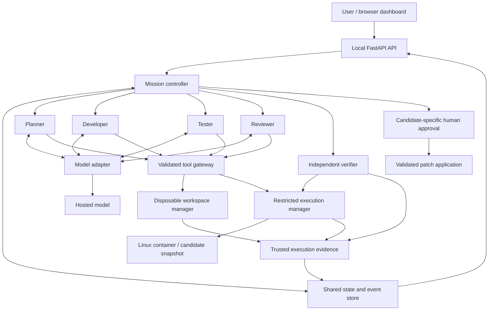

# DevPilot — Master Product and Implementation Plan

> **PECATHON 2026 · PS-001**  
> **The Mystic Mikado’s Autonomous AI Engineering Guild**  
> Team: 3 people · Build window: 12 hours  
> Document status: Implementation blueprint; application functionality and evaluation results are not yet verified.

---

## 0. Read This First

This document combines the user-supplied PS-001 requirements, the teammate’s implementation specification, and the agreed DevPilot product and engineering plan. It is a single handoff document for the team and its coding assistants, including Antigravity.

### Source and authority

- The organizer requirements below come from the PS-001 text supplied in the conversation.
- The teammate attributes that text to `PECathon_2026_Problem_Statements.pdf`, pages 1–4. The original PDF has not been independently inspected for this document.
- Appendix A consolidates the supplied source requirements; it is not a claimed verbatim PDF transcription.
- The problem statement permits any language, framework, existing model, agent framework, and local repository. GitHub and model training are not required.
- Technology choices, time budgets, agent count, and implementation milestones in this plan are team decisions, not organizer mandates.
- A competitive outcome is a goal, not a guarantee of winning.

**Precedence:** organizer rules and clarifications → user-approved scope → this plan → optional ideas.

Do not train a model. Do not substitute four sequential persona prompts for meaningful agent coordination. Do not report model assertions as executed evidence.

---

## 1. Product Objective and Positioning

Build a multi-agent engineering system that turns a natural-language request into a working, tested, reviewed change to an existing small repository.

> **An AI engineering guild that proves its changes work, adapts when evidence changes the plan, and asks permission before applying them.**

### Core user journey

```text
Connect repository
    → Describe the requested change
    → Inspect proposed acceptance criteria and resolve ambiguity
    → Authorize the bounded mission
    → Watch agents investigate, implement, test, and review
    → See findings trigger revised actions
    → Inspect the final diff and independent verification evidence
    → Approve application, export the patch, or reject it
```

### What makes the submission competitive

1. A complete real mission instead of a simulated agent dashboard.
2. A visible feedback loop where evidence changes the next action.
3. Evidence linked to the exact candidate that was checked.
4. Safe, bounded execution and human-controlled application.
5. A coherent PECFEST-inspired interface that makes the engineering understandable.

The objective is not maximum agent count, maximum infrastructure, or unsupported autonomy claims.

---

## 2. Scope and Decisions

### Initial delivery scope

- A local application with a browser dashboard.
- One active mission at a time; independent activities within that mission may run concurrently.
- Small Python repositories with dependencies prepared before execution.
- Local folder connection; Git metadata is useful but not mandatory.
- One hosted coding-capable model initially, shared by four separately configured agents.
- Planner, Developer, Tester, and Reviewer agents.
- A separate deterministic verification process.
- Structured messages, shared task state, persistent events, and bounded repair.
- Repository search/read/edit tools and approved diagnostic/check execution.
- Restricted Linux containers for repository code execution.
- Human approval bound to the final candidate before application.
- Controlled evaluation fixtures covering all five required scenario categories.

### Deferred until the core works

- Remote GitHub integration, PR creation, and cloud deployment.
- Arbitrary languages, package managers, and repository sizes.
- Local-model support unless hosted access becomes unavailable.
- Multiple simultaneous missions and multiple developer writers.
- Vector databases, embeddings, semantic code indexing, and distributed queues.
- Dynamic agent spawning, elaborate animations, voice controls, and agent avatars.
- Single-agent comparison until sufficient time remains for actual comparative runs.

### Known environment observations

Previously checked in the development environment:

- Python 3.12.10 is available.
- Node.js and Docker CLI executables are available.
- Docker’s Linux engine was unreachable at the time of the check.

These observations are not proof that dependencies, containers, or the application work. Recheck during setup. The demo-machine choice remains to be confirmed.

---

## 3. Proposed Stack

| Layer | Decision | Reason |
|---|---|---|
| Backend | Python 3.12 + FastAPI | One language for orchestration, repository tooling, and demo projects |
| Contracts | Typed validation models, using Pydantic with FastAPI | Validate tool requests, state transitions, messages, and API input |
| Frontend | HTML/CSS with modular JavaScript initially | Enough for the command center without a second complex build pipeline |
| UI alternative | React + TypeScript if the UI owner already has a usable setup | Make this decision at kickoff; do not maintain two frontends |
| Styling | Shared design tokens and reusable components | Map PECFEST design consistently after its Markdown is supplied |
| Model | One hosted model behind a provider adapter | Avoid local inference setup and unnecessary model routing |
| Orchestration | Custom explicit state machine and reusable agent runner | Keep routing, retries, and approval logic visible and testable |
| Live scheduling | In-process async tasks and bounded queues | Sufficient for one active mission |
| Persistence | SQLite plus an artifact directory | Durable mission history and evidence without an external database |
| Updates | Server-Sent Events (SSE) | Stream actual mission activity to the browser |
| Execution | Restricted Docker Linux containers | Enforce repository execution boundaries below model instructions |
| Demo checks | Prepared Python tests and focused security checks | Repeatable evidence on small controlled repositories |

LangGraph and other agent frameworks are allowed by the brief but are not required. Do not add a second orchestration system without a demonstrated need.

### Model integration gate

Before implementing live model calls, establish:

1. Provider and base URL.
2. Exact available model names.
3. Tool-calling or structured-output capabilities.
4. Context/output limits, concurrency limits, and practical rate limits.
5. Credential environment variable and authentication contract.

**Environment status:** The active workspace environment provides model access via an Anthropic-compatible hosted gateway:
- Base URL: Configured via `ANTHROPIC_BASE_URL` (`https://api.argmin.run/v1`).
- Credentials: Provided via `ANTHROPIC_API_KEY` (and `MEGALLM_API_KEY`).
- Model capabilities: Claude 3.5 Sonnet / Claude-compatible endpoint supporting structured tool use, system prompts, and JSON outputs.
- Swytchcode status: The local Swytchcode installation manages merchant/service tooling (e.g. Stripe); it does not provide an LLM integration layer. Model access is mediated through the backend's unified `ModelAdapter` consuming the verified provider gateway.

Keep credentials server-side and outside repository containers, artifacts, and UI payloads. Do not expose authorization headers or raw secrets in logs or SSE payloads.

---

## 4. UI and PECFEST Design Integration

### Design status

The PECFEST design Markdown has not yet been supplied. The teammate’s implementation specification is not the visual design reference.

When the design Markdown arrives, extract:

- Palette, typography, textures, and backgrounds.
- Borders, panels, buttons, navigation, and spacing.
- Japanese-inspired illustrations and motifs.
- Animation timing and interaction behavior.
- Responsive rules and available assets.

Translate those into shared design tokens. The visual layer can change without changing mission contracts or backend behavior.

### UI principles

- Pair themed names with practical labels: `Shogun / Planner`, `Samurai / Developer`.
- Make failures, blockers, and uncertainty as visible as successful activity.
- Render repository text and tool output as untrusted text, not executable HTML.
- Display short decision summaries and evidence, not private model reasoning.
- Avoid invented conversations, fake progress percentages, or scripted success animations.
- Support keyboard navigation, readable contrast, reduced motion, and desktop-first responsive layouts.

### Screen A — Mission Entrance

**Purpose:** strong first impression and fast access to a real demonstration.

- DevPilot title, PECATHON identity, and concise product proposition.
- `Connect Repository` primary action.
- `Open Demo Repository` action.
- Recent missions with actual outcomes.
- Readiness indicators for model connection, execution environment, and supported projects.

### Screen B — Repository and Mission Setup

**Repository panel:**

- Authorized repository folder and detected project type.
- File tree, included file count, and excluded-file summary.
- Existing changes indicator and selected execution profile.
- Preflight warnings or blockers with specific remediation.

**Mission panel:**

- Natural-language request.
- Proposed acceptance criteria.
- Clarification questions and answers.
- Time, call, and repair budgets.
- Clear authorization to edit and execute inside the disposable workspace.
- `Start Mission` action.

Material scope changes require renewed clarification/authorization. Routine repairs within approved scope do not need a prompt for every tool call.

### Screen C — Live Command Center

```text
┌─────────────────────────────────────────────────────────────────┐
│ Mission title · Candidate version · Elapsed time · Budget · Stop│
├───────────────┬───────────────────────────┬─────────────────────┤
│ GUILD         │ LIVE ACTIVITY             │ INSPECTOR           │
│               │                           │                     │
│ Planner       │ Task assigned             │ Acceptance criteria │
│ Developer     │ File searched/read        │ Selected tool call  │
│ Tester        │ Candidate submitted       │ File / diff         │
│ Reviewer      │ Check failed              │ Check output        │
│               │ Repair requested          │ Finding + evidence  │
├───────────────┴───────────────────────────┴─────────────────────┤
│ Tasks: Pending → Working → Blocked / Awaiting Check → Completed │
└─────────────────────────────────────────────────────────────────┘
```

Interactions:

- Select an event to inspect validated arguments, result, timestamps, and status.
- Select a finding to inspect its evidence and assigned repair task.
- Select a file to inspect the candidate diff.
- Select a criterion to inspect the check supporting its status.
- Answer clarification questions without discarding the mission.
- Stop the mission and terminate active execution through the controller.

**Signature demo moment:** a real failure creates a finding, reopens a task, changes the plan, and leads to a new candidate. Animate that transition only when the corresponding events exist.

### Screen D — Evidence and Human Approval

- Final candidate identity and diff.
- Baseline versus candidate outcomes.
- Criteria marked `VERIFIED`, `FAILED`, or `UNVERIFIED` with evidence references.
- Real checks, results, durations, and bounded output.
- Review findings, severity, and resolutions.
- Repair count, model/tool usage where measurable, and unresolved issues.
- `Approve & Apply`, `Export Patch`, `Reject`, and `Download Mission Report`.

`Verified — awaiting approval` and `Applied` are different outcomes. Merely exporting a patch does not mean it has been applied.

---

## 5. Architecture and Trust Boundaries



### Trusted controller responsibilities

- Enforce permissions and valid transitions.
- Schedule ready tasks and route findings.
- Track candidate versions and task attempts.
- Grant one workspace writer at a time.
- Reject stale or duplicate completion messages.
- Capture execution evidence outside model-generated text.
- Enforce budgets, cancellation, and human approval.

The model proposes actions. Application code validates and executes them. The model cannot directly run shell strings or mark a mission verified.

---

## 6. Repository Connection and Workspace Lifecycle

### Initial connection method

The user supplies a local folder path to the locally running backend. The browser itself does not receive unrestricted filesystem access.

Remote cloning is not necessary for the initial submission. A repository downloaded beforehand is connected as a local folder.

### Connection workflow

1. Validate that the selected directory exists and is explicitly authorized.
2. Confirm the project matches a supported execution profile.
3. Reject unsupported size, file types, unsafe paths, and special filesystem entries.
4. Build an inclusion manifest using exclusions and project ignore rules.
5. Record fingerprints, relevant Git state, and existing modifications.
6. Create a disposable snapshot containing the approved files.
7. Run approved baseline checks inside restricted execution.
8. Expose repository tools only against the registered workspace identifier.

### Exclusions by default

- `.env` files and known credential/key files.
- Git internals.
- Dependency folders, virtual environments, caches, and generated outputs.
- Large binaries and unsupported file types.
- Symlinks, junctions, and other filesystem entries that could escape the workspace.

Do not assume filename exclusions find every secret. Scan selected content and outgoing/logged data for obvious secrets, report the limitation, and allow explicit exclusion before model transmission.

### Preserve existing work

- Record dirty tracked files and explicitly selected untracked files.
- Never reset, clean, or overwrite the original repository to prepare a mission.
- Make the inclusion/exclusion rules visible.
- Do not silently copy only a clean commit if doing so would omit the user’s current work.

### Working copy versus security sandbox

A temporary directory or Git worktree separates edits. It is not an execution sandbox.

- Use a disposable copy as the default to preserve selected working-tree contents.
- Git metadata may help inspect status/diffs.
- Restricted containers enforce the execution boundary for repository code.
- Do not mount Git administration paths that grant access outside the selected snapshot.

### Candidate lifecycle

```text
Original selected state
    → Baseline snapshot
    → Mutable agent workspace
    → Frozen candidate v1
    → Test/review evidence for v1
    → Repair workspace
    → Frozen candidate v2
    → New evidence for v2
    → Human approval for v2
    → Validated application
```

Hash candidate contents and record the relevant check profile and acceptance-criteria version. New code or changed criteria invalidates affected prior evidence.

### Application gate

Before applying:

- Verify approval names the exact candidate fingerprint and intended action.
- Recheck the original repository against its starting fingerprints.
- Reject conflicts instead of overwriting newer work.
- Validate patch paths again.
- Use an application journal/backups and report partial application if recovery is required.
- Record the applied result separately from the verified candidate.

No commit, merge, push, deployment, or external-target application is implied by starting a mission.

---

## 7. Repository Search and Context Strategy

Use progressive, bounded exploration instead of sending the entire repository to the model.

### Initial context

- Request and approved acceptance criteria.
- Project summary and bounded file tree.
- Relevant manifest and test-profile information.
- Discovered conventions and baseline results.

### Investigation example

```text
Request: add status filtering
    → Search status/task-list references
    → Read relevant handler and tests
    → Read validation, sorting, and pagination helpers
    → Identify current behavior and likely risks
    → Make a targeted change
    → Run a focused check and inspect evidence
```

### Search behavior

- Return relative paths, line numbers, and bounded snippets.
- Support literal and bounded regex searches.
- Exclude manifest-denied files.
- Cap result count, file size, and response size.
- Read code as text; do not import/execute it to discover symbols.
- Defer vector search and embeddings for the small-repository scope.

Repository comments, README files, and tool output are untrusted project data. They cannot grant permissions, change approval rules, or instruct the model to reveal credentials.

---

## 8. Agent Runner and Contracts

An agent is an existing model plus role instructions, scoped context, permitted tools, task memory, and an execution loop. Four agents do not require four models or keys.

### Reusable runner

```text
Receive assigned task and relevant messages
    → Call model through configured adapter
    → Parse tool request, finding, clarification, or task result
    → Validate schema, permissions, and remaining budget
    → Execute permitted tool or route structured message
    → Persist actual result
    → Return result to the agent
    → Continue until task result, blocker, cancellation, or limit
```

Malformed requests receive bounded corrective feedback. Repeated malformed requests stop the task; the runner must not loop forever.

### Planner — Shogun

**Input:** request, repository summary, baseline evidence, findings, user answers.

**Tools:** list/read/search, task proposals, structured messages, clarification requests.

**Output:**

- Objective and testable acceptance criteria.
- Dependency-aware tasks and owners.
- Relevant files/conventions and risks.
- Verification approach per criterion.
- Clarification questions and revised plans.

The Planner may revise work after new evidence. It cannot manufacture test evidence or approve application.

### Developer — Samurai

**Input:** assigned task, criteria, relevant code, conventions, failures, and review findings.

**Tools:** read/search, targeted patch, diff inspection, approved diagnostics/checks.

**Output:**

- Candidate-ready handoff and changed files.
- Short rationale and evidence references.
- Remaining risks, requested checks, or blocker.

The Developer must select and use at least three distinct tool categories during the showcase where appropriate. It cannot weaken protected checks, approve its final work, or modify the original repository directly.

### Tester — Sentinel

**Input:** criteria, baseline results, candidate identity, existing tests, review check requests.

**Tools:** read/search, approved checks, controlled test authoring when authorized.

**Output:**

- Executed check identity, command, exit status, duration, and output references.
- Failed test identities when available.
- Reproduction, diagnosis clearly labeled as a hypothesis, and coverage gaps.
- Structured findings for Planner/Developer/Reviewer.

Distinguish product failures from environment failures, timeouts, absent tools, and baseline defects. Test writing requires exclusive write ownership; checking runs against a frozen candidate.

### Reviewer — Shadow Council

**Input:** request, criteria, relevant code, candidate diff, test evidence, basic scan results.

**Tools:** read/search/diff, approved static checks, messages and check requests.

**Output:** severity-ranked findings with locations, evidence, expected behavior, and required resolution.

Review correctness, readability, conventions, regressions, exposed secrets, unsafe operations, injection risks, and suspicious test weakening. An approval recommendation is not human approval.

### Independent verifier

Use a separate deterministic process initially, as allowed by PS-001.

- Run protected acceptance checks unavailable for Developer modification.
- Bind results to the exact candidate and criteria version.
- Validate that expected checks actually executed.
- Reject missing, stale, malformed, or mismatched evidence.
- Mark each criterion verified, failed, or unverified.

Prepared demo fixtures provide trusted checks. For newly connected repositories, a criterion without an adequate approved check remains unverified or requires human inspection. An agent-generated test is useful but not automatically a trustworthy independent oracle.

---

## 9. Tool Layer and Permissions

The following are proposed internal DevPilot tool names, not external integration canonical IDs.

| Tool | Purpose | Main constraints |
|---|---|---|
| `list_files` | Inspect project structure | Registered workspace and inclusion manifest |
| `search_text` | Locate code, tests, identifiers, and errors | Bounded search and output |
| `read_file` | Read relevant file sections | Relative paths, size limits, excluded-file rejection |
| `apply_patch` | Make targeted changes | Writer lease, expected version, path validation |
| `read_diff` | Inspect candidate changes | Baseline/candidate-specific |
| `run_check` | Run approved test/build/static-check profiles | Fixed executable/argument policy inside restricted execution |
| `report_finding` | Send structured evidence | Task/candidate/evidence references required |
| `request_clarification` | Ask a material question | Persist question and pause affected tasks |

### Permission enforcement

- Apply policy outside model instructions.
- Resolve/canonicalize paths and reject traversal, alternate-path escapes, symlinks, and special entries.
- Never expose unrestricted host filesystem tools.
- Never accept an arbitrary shell string from the model.
- Execute vetted command profiles with argument validation, not shell interpolation.
- Restrict test selectors and environment overrides; they must not bypass required checks.
- Enforce time, memory, process, output, and disk budgets.
- Terminate the execution environment on timeout/cancellation, including descendants.
- Redact credentials in model/tool errors, logs, UI, and exported reports.

Even an approved test runner executes repository code. An allowlist does not replace an OS-enforced execution boundary.

---

## 10. Shared State, Events, and Adaptive Orchestration

### Core records

| Record | Fields |
|---|---|
| Mission | ID, workspace, request, state, scope version, limits, unresolved issues |
| Criterion | ID, expected behavior, verification method, status, evidence references |
| Task | ID, owner, dependencies, state, attempt, candidate, completion condition |
| Message | ID, sender, recipient, task, type, candidate, payload, evidence references |
| Candidate | ID, parent, content fingerprint, changed files, criteria version |
| Tool execution | ID, tool/profile, sanitized arguments, timestamps, result, output artifact, candidate |
| Finding | ID, source, severity, location, observed/expected behavior, evidence, resolution |
| Approval | ID, candidate fingerprint, intended action, user decision, timestamp, application result |
| Event | Sequence, type, source, related record IDs, safe display payload, timestamp |

Use one canonical schema per concept. Do not maintain conflicting mission models in multiple modules.

### Communication example — illustrative, not a measured run

```text
Tester → Developer + Planner:
  Candidate 2 fails pagination check; evidence E17 attached.

Planner → Developer:
  Reopen pagination repair; preserve accepted filtering behavior.

Reviewer → Tester:
  Request an empty-result regression check.

Developer → Tester + Reviewer:
  Candidate 3 is ready; operation ordering changed.
```

The next agent receives the relevant messages and artifacts. Do not put every transcript into every agent context.

### Scheduler rules

- Controller code owns state transitions; agents propose them.
- Schedule only tasks whose dependencies are ready.
- One writer per workspace.
- Test and review may read the same frozen candidate in parallel.
- Reject stale result submissions for superseded candidates.
- Deduplicate messages and completion events using stable identities.
- Persist state and its corresponding event together where possible.
- Keep live queues bounded; SQLite is the source of truth, not an in-memory queue.

### Adaptive decisions

| Condition | Action |
|---|---|
| Baseline failure | Investigate and revise task plan |
| Reproducible test failure | Assign repair with evidence |
| Review finding | Request investigation, check, repair, or human resolution |
| Unsupported requirement | Clarify or report scope limitation |
| Transient model/network error | Bounded retry with backoff |
| Tool unavailable | Use an approved equivalent if one exists; otherwise block |
| Repeated unresolved failure | Escalate or stop |
| Missing/stale verification evidence | Reject completion |
| Checks clean and blocking findings resolved | Run independent verification |
| Final verification complete | Request candidate-specific human approval |

Never retry a side-effecting operation blindly after an uncertain result; inspect saved state first.

### Proposed starting budgets

- Maximum 3 repair rounds.
- Escalate after 2 unsuccessful repair attempts for the same unchanged failure.
- Maximum 10 minutes per small-fixture mission.
- Maximum 60 seconds per check initially, configurable by execution profile.
- Explicit model-turn, tool-call, and token budgets.
- Output and artifact size caps.

These are initial settings, not benchmark-derived optimal values.

### User-visible mission outcomes

- Planning / Running / Checking / Repairing.
- Needs clarification.
- Blocked.
- Interrupted.
- Cancelled.
- Budget exhausted.
- Failed verification.
- Verified — awaiting approval.
- Rejected.
- Applied.

A backend restart marks unfinished work interrupted. Reconcile saved operations before resuming; never claim transparent exactly-once recovery without implementing it.

---

## 11. Execution Isolation and Security

### Container policy

- Non-root identity.
- Minimal, prepared runtime image with controlled dependencies.
- No host home-directory, credential, or Docker-socket mounts.
- No privileged mode; drop unnecessary capabilities and prevent privilege escalation.
- Network disabled for repository execution.
- Read-only root filesystem with explicitly bounded temporary writable storage.
- Verification candidate mounted read-only.
- Resource, process, time, output, and storage limits.
- Separate containers or temporary resources for concurrent checks where needed.
- Trusted controller retains model credentials outside the container.

Containers still require correctly configured boundaries and tested assumptions. The project does not claim production-grade containment for arbitrary hostile workloads.

### Local application boundary

- Bind to loopback by default.
- Use a local session token and origin checks for sensitive API operations.
- Do not expose an unauthenticated API that accepts arbitrary host paths or commands.
- Treat UI filenames, diffs, tool results, and model content as untrusted display data.
- Keep mission artifacts outside the candidate’s writable area.
- Deny execution when the isolation prerequisite is unavailable.

### Basic security inspection

Combine deterministic scans and code review for:

- Obvious exposed secrets using synthetic fixtures.
- Unsafe command construction and injection-prone operations.
- Unsafe execution primitives relevant to the demo projects.
- Unexpected file access or destructive behavior.
- New dependency/install behavior.
- Removal or weakening of important tests.

These checks are basic coverage, not a comprehensive security audit. Unknown risks remain explicitly reported.

---

## 12. Testing, Independent Verification, and Evidence

### Baseline first

Before implementation, capture existing checks and failures. Distinguish pre-existing defects from regressions.

### Evidence record

For each check, capture:

- Mission, task, attempt, candidate fingerprint, and criteria version.
- Check profile and actual command/arguments.
- Start/end timestamps and duration.
- Exit code, timeout/cancellation status, and infrastructure errors.
- Bounded stdout/stderr artifacts.
- Collected/executed tests and individual results where available.
- Verification coverage and unresolved gaps.

The execution manager writes authoritative evidence. Model descriptions may refer to it but cannot replace it.

### A successful process is not sufficient

- Exit code 0 does not prove the feature meets its criteria.
- An empty or skipped test run does not mean acceptance checks passed.
- Build/lint results must not be presented as behavioral test coverage.
- A result from candidate v1 does not certify candidate v2.
- Missing tests or unavailable tools must remain visible as gaps.

### Completion gate

A candidate is `Verified — awaiting approval` only when:

1. Required acceptance criteria have valid supporting evidence.
2. Required baseline/regression checks meet the approved outcome policy.
3. No unresolved blocking review/security findings remain.
4. The independent verifier accepts evidence for the current candidate.
5. Remaining nonblocking limitations are disclosed.

Human acceptance of a limitation must be explicit; the model cannot waive a requirement for itself.

### Platform tests

- Path traversal, symlink/junction, and excluded-file rejection.
- Disallowed commands/arguments and environment overrides.
- Timeout, resource limits, and cancellation cleanup.
- Stale evidence and wrong-candidate approval rejection.
- Duplicate completion message handling.
- Original-repository modification conflict detection.
- Protected-check immutability.
- No API credentials in repository execution, UI events, or reports.
- Interrupted mission handling without blind side-effect retries.

Use deterministic tests for controller/tool correctness. Evaluate model-driven task behavior through actual controlled missions, not brittle assertions on exact wording.

---

## 13. Backend API and Event Contract

These are proposed internal application endpoints, not implemented capabilities.

| Method and route | Purpose |
|---|---|
| `GET /api/health` | Application readiness; avoid exposing secrets |
| `POST /api/repositories/connect` | Register and preflight an explicitly authorized local repository |
| `GET /api/repositories/{id}/tree` | Return approved bounded repository tree |
| `GET /api/repositories/{id}/file` | Read bounded repository file content for IDE code viewer |
| `POST /api/missions` | Create mission and return its identifier |
| `GET /api/missions/{id}` | Current state, tasks, criteria, and budgets |
| `GET /api/missions/{id}/events` | SSE stream with event IDs and reconnect replay |
| `POST /api/missions/{id}/clarifications` | Record a user answer and resume eligible work |
| `POST /api/missions/{id}/cancel` | Stop future calls and cancel active execution |
| `GET /api/missions/{id}/candidates/{candidate}/diff` | Inspect the exact candidate diff |
| `GET /api/missions/{id}/candidates/{candidate}/file` | Read candidate snapshot file content for IDE code viewer |
| `GET /api/missions/{id}/evidence/{evidence}` | Inspect authorized evidence artifacts |
| `POST /api/missions/{id}/approve` | Record candidate/action-specific approval |
| `POST /api/missions/{id}/apply` | Validate approval and original state; apply patch |
| `POST /api/missions/{id}/reject` | Reject the proposed candidate |
| `GET /api/missions/{id}/report` | Final evidence-backed report |
| `GET /api/missions/{id}/patch` | Export patch without claiming application |

### Event delivery

- Persist events with a monotonically increasing sequence per mission.
- Include task, candidate, and evidence references when relevant.
- Stream sanitized display payloads.
- Support reconnection from the last received event.
- Browser disconnect does not implicitly cancel the mission.
- Mission tasks belong to application lifecycle management, not the lifetime of an SSE request.

Use supported Python 3.12 concurrency primitives; do not assume newer Python-only queue APIs exist.

---

## 14. Proposed Project Layout

```text
DevPilot/
├── DEVPILOT_MASTER_PLAN.md
├── README.md
├── .gitignore
├── frontend/
│   ├── index.html
│   └── src/
│       ├── app.js
│       ├── api.js
│       ├── events.js
│       ├── components/
│       ├── screens/
│       └── styles/
├── backend/
│   ├── app/
│   │   ├── main.py
│   │   ├── settings.py
│   │   ├── api/
│   │   │   ├── repositories.py
│   │   │   ├── missions.py
│   │   │   ├── events.py
│   │   │   └── approvals.py
│   │   ├── agents/
│   │   │   ├── runner.py
│   │   │   ├── planner.py
│   │   │   ├── developer.py
│   │   │   ├── tester.py
│   │   │   └── reviewer.py
│   │   ├── orchestrator/
│   │   │   ├── controller.py
│   │   │   ├── scheduler.py
│   │   │   └── policy.py
│   │   ├── models/
│   │   │   ├── mission.py
│   │   │   ├── messages.py
│   │   │   └── evidence.py
│   │   ├── tools/
│   │   │   ├── gateway.py
│   │   │   ├── files.py
│   │   │   ├── search.py
│   │   │   ├── editor.py
│   │   │   └── checks.py
│   │   ├── services/
│   │   │   ├── model_adapter.py
│   │   │   ├── repository.py
│   │   │   ├── execution.py
│   │   │   ├── verification.py
│   │   │   └── application.py
│   │   └── storage/
│   │       ├── database.py
│   │       └── artifacts.py
│   ├── tests/
│   ├── requirements.txt
│   └── .env.example
├── sandbox/
│   ├── Dockerfile
│   └── profiles/
├── sample-repos/
├── evaluation/
│   ├── scenarios/
│   ├── protected-checks/
│   └── results/
└── docs/
    └── assets/
```

Adapt the frontend layout if React is selected at kickoff. Do not introduce duplicated modules just to match this tree. Runtime credentials, disposable workspaces, and sensitive logs must not be committed.

---

## 15. Primary Demonstration

### Demo repository

A small task manager with known conventions, prepared dependencies, baseline tests, and protected acceptance checks.

### User request

> Add status filtering, reject unsupported statuses, and preserve existing sorting behavior.

### Controlled feedback trigger

Include a disclosed seeded sorting defect with a failing baseline check. This reliably supplies new evidence without instructing the Developer to make a deliberate mistake.

### Target demonstration sequence

1. Connect the existing repository.
2. Submit the request and inspect criteria.
3. Run baseline checks; expose the seeded failure.
4. Tester sends evidence to Planner and Developer.
5. Planner revises tasks to include sorting investigation/repair.
6. Developer uses read/search/edit/diagnostic tools to implement and repair.
7. Freeze a candidate; Tester and Reviewer inspect it.
8. Route additional findings back if they arise.
9. Independent verifier checks the final candidate.
10. Display evidence and request human approval.
11. Apply only after approval and original-state validation.

This is the intended path, not a fabricated result. Record actual runs. If the mission fails, retain and report that outcome.

### Suggested short presentation

- Explain the request and repository.
- Show the initial failure and corresponding plan change.
- Open the developer action caused by that finding.
- Show final actual checks and independent acceptance evidence.
- Inspect the diff and approval gate.
- Briefly show one unexpected-condition outcome.

Recorded replays must be labeled as recordings. Do not present replayed events as a live run.

---

## 16. Required Evaluation Scenarios

| Scenario | Fixture / request | Required evidence |
|---|---|---|
| Feature implementation | Add a small feature to an existing project | Criteria, relevant searches, minimal diff, behavior and regression checks |
| Bug investigation | Seed a defect with contextual clues | Reproduction, repository investigation, repair, rerun |
| Test-driven recovery | Begin with a failing test | Tester finding, developer response, changed action, final result |
| Security and code review | Plant a controlled vulnerability or quality issue | Scan/reviewer finding, evidence, remediation or explicit escalation |
| Unexpected conditions | Missing tool, ambiguous requirement, repeated failure | Bounded retry/change/clarification/stop behavior and logs |

Each category needs recorded execution. A single fixture may support more than one scenario, but report which scenario was exercised and do not inflate run counts.

### Evaluation measures

- Criteria verified, failed, and unverified.
- Mission outcomes including blocked and failed attempts.
- Repair attempts and evidence-driven plan changes.
- Tool calls and denied operations.
- Checks executed and their results.
- Runtime and latency.
- Token usage when supplied by the provider; cost only if pricing is known and identified.

Do not invent percentages or claim broad reliability from one successful mission.

---

## 17. Twelve-Hour Team Execution Plan

### Ownership

| Person | Primary responsibility |
|---|---|
| Person 1 | Model adapter, agent runner, controller, schemas, state/events |
| Person 2 | Repository connection, tools, container execution, verification, safe application |
| Person 3 | PECFEST-inspired UI, real event rendering, demo fixtures support, presentation |

Agree on message, task, tool-result, candidate, and evidence contracts before parallel implementation. Give shared files a single owner.

### Timeline

| Window | Person 1 | Person 2 | Person 3 |
|---|---|---|---|
| 0–1 h | Confirm contracts and model capabilities | Prove isolation and prepare fixture | Read design MD; settle frontend and design tokens |
| 1–3 h | Runner/controller foundation and event store | Connect/snapshot/read/search/patch tools | Setup screen and command-center shell |
| 3–5 h | Developer–Tester feedback loop | Real checks and candidate evidence | Display real events, files, and output |
| 5–7 h | Planner revisions and Reviewer routing | Independent verification and boundaries | Findings, tasks, and diff interactions |
| 7–9 h | Limits, clarification, and interruption | Approval/application and conflict handling | Evidence report and approval flow |
| 9–10 h | Integrated scenario runs | Regression/boundary tests | Polish and rehearse |
| 10–12 h | Fix blockers; finalize architecture docs | Save reproducible results and artifacts | Record demo; finish presentation |

### Checkpoints

- Hour 1: model access and restricted execution are usable.
- Hour 3: agents can inspect an actual connected repository.
- Hour 5: real edit → real test → finding consumed by Developer.
- Hour 7: a full mission reaches independent verification.
- Hour 9: approval flow and important failure conditions work.
- Final hours: freeze features, stabilize, evaluate, and document.

If behind, cut animation, extra screens, and bonuses. Do not replace actual execution with fabricated results or silently weaken boundaries.

---

## 18. Implementation Milestones

### M1 — Runnable foundation

- Inspect selected project workspace and preserve existing work.
- Add application settings, health endpoint, canonical schemas, and mission create/status API.
- Establish database/artifact interfaces and basic lifecycle handling.
- No live model call required yet.

**Exit evidence:** application starts; health and schema/API checks execute successfully.

### M2 — Restricted repository tools

- Connect/snapshot a controlled repository.
- Implement path/inclusion policy, read/search/edit, diff, and command profiles.
- Prove container restrictions, timeout, and cancellation behavior.

**Exit evidence:** real tool operations work; denied operations are demonstrably denied.

### M3 — First working vertical slice

- Configure the model through the verified integration contract.
- Build the reusable agent tool loop.
- Let a Developer inspect and modify a small task using real tool choices.
- Execute an actual check and save its output.

**Exit evidence:** real model-driven tools, real diff, real check. A hardcoded edit or single text response is not the final agent implementation.

### M4 — Shared multi-agent coordination

- Add Planner, Tester, and Reviewer contracts.
- Persist tasks, messages, findings, and candidate identities.
- Route agent outputs into subsequent work.

**Exit evidence:** an agent consumes another agent’s finding and changes its action.

### M5 — Adaptive recovery and bounds

- Failure → investigation → repair → rerun.
- Review findings can also trigger repair.
- Enforce budgets, clarification, stop, and interruption outcomes.

**Exit evidence:** saved feedback loop and a bounded failure case.

### M6 — Independent verification and approval

- Protected checks and candidate-bound evidence.
- Reject stale evidence and wrong-candidate approvals.
- Human-approved application with conflict detection.

**Exit evidence:** final verification and approval/application gates exercised.

### M7 — Transparency UI

- Complete setup, console, inspector, diff, evidence, and approval screens.
- Render persisted events and reconnect correctly.
- Apply the supplied PECFEST design language.

**Exit evidence:** full browser journey reflects actual backend state.

### M8 — Required evaluation

- Exercise all five scenario categories.
- Run platform safety/reliability checks.
- Save actual outputs and update traceability status.

**Exit evidence:** reproducible run artifacts, including failures and gaps.

### M9 — Packaging and demonstration

- Finish setup/configuration, architecture, supported tools, security assumptions, and limitations.
- Capture at least one complete mission and evidence-driven feedback loop.
- Rehearse and package source/demo artifacts.

**Exit evidence:** another teammate can follow documented setup and inspect saved evidence.

UI work can proceed in parallel against agreed contracts; the backend milestones remain dependency-driven.

---

## 19. Deliverables and README

### Required deliverables

- Source code and working demonstration.
- Defined agent roles and architecture.
- Implementation, testing, review, and independent verification workflow.
- At least one end-to-end mission with a feedback-loop run log.
- Setup instructions and configuration examples.
- Supported tools and execution profiles.
- Controlled evaluation fixtures/scenarios and actual results.

### README structure

1. Product objective and supported scope.
2. Architecture diagram and component responsibilities.
3. Agent contracts and communication.
4. Shared state, candidate versions, and adaptive orchestration.
5. Setup and model configuration.
6. Container prerequisites and prepared execution profiles.
7. Repository connection and inclusion/exclusion rules.
8. Available tools and permissions.
9. Human approval and application behavior.
10. Demo instructions and reproducible evaluations.
11. Measured results with artifact references.
12. Security assumptions and known limitations.
13. Unimplemented features and remaining requirements.

Configuration examples contain variable names and documentation, never real credentials. Generated evidence must be inspected for secrets before inclusion in a public repository.

---

## 20. Definition of Done

- [ ] A user can submit a natural-language request against an existing controlled repository.
- [ ] Repository reconnaissance occurs before implementation.
- [ ] Objectives, acceptance criteria, tasks, and dependencies are explicit.
- [ ] Developer selects and uses at least three distinct tool categories in the showcase.
- [ ] Agents exchange structured findings and respond to one another’s evidence.
- [ ] At least one complete mission and real feedback loop are recorded.
- [ ] Actual checks run; results correspond to the reviewed candidate.
- [ ] Independent acceptance verification is implemented.
- [ ] Review/security findings can trigger repair or human escalation.
- [ ] File/command boundaries and runtime limits are enforced and tested.
- [ ] Approval is required before applying the final change.
- [ ] Repeated failure, ambiguity, missing tools, and cancellation have explicit outcomes.
- [ ] All five required evaluation categories are exercised; any gap is disclosed as incomplete.
- [ ] Final report separates verified outcomes, failed checks, assumptions, and unresolved issues.
- [ ] README, setup, configuration, supported tools, and demonstration are complete.

Disclosure of a gap is honest reporting, not fulfillment of that requirement. Do not mark the project fully complete while mandatory items remain unmet.

---

## 21. Risks and Scope Controls

| Risk | Early check | Response |
|---|---|---|
| Model/tool incompatibility | Verify exact endpoint/model behavior in hour 1 | Resolve provider configuration before building around assumptions |
| Docker unavailable | Execute a controlled isolation check | Fix environment or use another pre-approved working machine; do not silently run on host |
| Integration configuration missing | Inspect enabled Swytchcode contract | Ask for the required configuration permission; do not invent IDs |
| Frontend consumes the schedule | Hour-5 real-loop checkpoint | Reduce decoration and secondary interactions |
| Agents conflict or use stale evidence | Writer lease and candidate checks | Freeze snapshots and invalidate affected evidence |
| Overbroad repository scope | Preflight profile validation | Reject unsupported projects with a clear explanation |
| Unexpected network/model failure | Bounded retry and saved state | Stop honestly when no valid fallback exists |
| Primary demo fails | Rehearse and retain actual run logs | Fix or disclose; label any recorded replay clearly |

---

## 22. Bonuses — Only After Core Completion

1. Concurrent testing and review on the same frozen candidate.
2. Persistent mission history and resumable interrupted work with reconciled side effects.
3. Automatic bounded reruns and repair.
4. Comparison with a single-agent baseline on the same tasks and comparable budgets.
5. Local model support after compatibility testing.
6. Dynamic agents only when task dependencies and isolation justify them.

Repair loops are already core functionality; bonuses should strengthen demonstrated behavior, not distract from mandatory requirements.

---

## Appendix A — Organizer Requirement Summary

### A. Shogun’s Council: Planning

- Convert requests into objectives and acceptance criteria.
- Inspect relevant files, conventions, and risks.
- Decompose, delegate, and revise tasks when new information appears.
- Share task status, findings, decisions, and open issues.

### B. Samurai Forge: Implementation

- Developer chooses among at least three tools, such as read/search, edit, and terminal commands.
- Follow existing style and structure.
- Investigate unexpected errors and change approach.
- Restrict file/command access and block destructive operations.

### C. Sentinel Dojo: Testing and Verification

- Run actual tests or build/lint checks.
- Investigate failures, communicate them, and rerun after repair.
- Use an independent verifier agent or process.
- Record changes, check results, and unresolved issues; do not claim success without evidence.

### D. Shadow Council: Review and Security

- Review correctness, readability, consistency, and regressions.
- Run basic secret/unsafe-operation/injection checks.
- Send review findings back; resolve disagreements through evidence or human escalation.
- Require human approval before consequential actions such as applying or merging changes.

### E. Living Campaign: Coordination and Adaptive Autonomy

- Agents exchange and use findings; sequential personas alone do not qualify.
- Failures and review findings trigger investigation and revised actions.
- Decide whether to continue, retry, clarify, or stop.
- Enforce success conditions, limits, permissions, escalation, and tool-failure handling.

### Required evaluation and reporting

- Feature implementation preserving existing behavior.
- Seeded bug investigation.
- Repair of an existing failing test.
- Detection and handling of a planted security/quality issue.
- Handling unavailable tools, ambiguous requirements, or repeated failures.
- At least one complete mission and one evidence-driven feedback loop.
- All reported results come from actual runs; distinguish evidence from model claims.

### Deliverables, documentation, and bonuses

- Source, working demonstration, defined roles, workflow, feedback-loop run log, setup/configuration, and supported tools.
- README covers architecture, communication, orchestration, state, setup, execution boundaries, approvals, assumptions, and limitations.
- Bonus opportunities include parallel/dynamic agents, automatic recovery, persistent memory, and a single-agent comparison.

---

## Appendix B — Requirement-to-Implementation Traceability

**Initial status for every item: NOT RUN.** After implementation, assign `PASS`, `PARTIAL`, or `FAIL` with an actual artifact reference. A plan or code location alone is not proof of runtime behavior.

| ID | Requirement | Planned location | Required evidence |
|---|---|---|---|
| A1 | Objectives and criteria | Planner, mission schemas | Saved criteria and clarification record |
| A2 | Repository reconnaissance | Repository service, search/read tools | Pre-edit tool events and findings |
| A3 | Decomposition/delegation/replanning | Controller, scheduler, Planner | Task dependencies and revised plan event |
| A4 | Shared mission state | Storage, schemas, events | Cross-agent state/message records |
| B1 | Three tool categories | Runner and tool gateway | Actual read/search, edit, and command events |
| B2 | Context-aware implementation | Developer and Reviewer | Targeted diff and convention review |
| B3 | Adaptive investigation | Findings and repair routing | Evidence changes next action |
| B4 | Controlled execution | Gateway, execution manager | Boundary and denied-operation tests |
| C1 | Automated checks | Check profiles, Tester | Real command/result artifacts |
| C2 | Failure analysis and repair | Tester, Developer, controller | Failure → finding → repair → rerun log |
| C3 | Independent verification | Verification service, protected checks | Criterion-specific final results |
| C4 | Evidence-based completion | Evidence store and completion gate | Rejection of absent/stale evidence; final report |
| D1 | Code review | Reviewer and diff service | Findings and reviewed candidate identity |
| D2 | Basic security inspection | Reviewer and scan profiles | Synthetic vulnerability/secret check evidence |
| D3 | Cross-agent critique | Message routing and escalation | Consumed finding and resolution/escalation |
| D4 | Human oversight | Approval API and application service | Approval gate and conflict tests |
| E1 | Meaningful communication | Structured messages and agent contexts | Finding consumed by another agent |
| E2 | Feedback loops | Controller and repair tasks | Revised action after new evidence |
| E3 | Adaptive choices | State machine | Continue/retry/clarify/stop scenario records |
| E4 | Bounded autonomy | Policy and execution manager | Exhaustion, timeout, and missing-tool outcomes |
| F1 | Feature scenario | Evaluation fixtures | Feature and regression checks |
| F2 | Bug scenario | Evaluation fixtures | Reproduction, investigation, verified repair |
| F3 | Failing-test recovery | Evaluation fixtures | Baseline failure and rerun result |
| F4 | Security/review scenario | Evaluation fixtures | Finding and remediation/escalation |
| F5 | Unexpected conditions | Evaluation fixtures | Safe bounded behavior logs |
| F6 | Complete mission and feedback | Primary demonstration | Saved end-to-end run |
| G1 | Honest reporting | Report service and UI | Evidence/model-claim separation |
| G2 | Runnable source and configuration | Application and README | Setup smoke test by another teammate |
| G3 | Architecture/roles/workflow | README and this plan | Documentation matches actual code |
| G4 | Tools, boundaries, approval, limitations | README | Tested behavior linked to documentation |

---

## Appendix C — Coding-Agent Handoff Instructions

Read this entire document before changing application code. Inspect the selected project workspace, applicable instructions, existing files, dependencies, and runnable commands. Do not assume the working directory is the project or overwrite existing work.

First report:

1. Existing workspace state.
2. Available runtime and execution isolation.
3. Missing model/provider integration information.
4. A short milestone plan and any blockers.

Then implement M1 only as the first bounded delivery. Once verified, continue through later milestones within the user’s authorization, reporting actual checks after each milestone. Do not build the whole application in an unverified code dump.

Use an existing model; do not train one. Follow the active workspace’s external-integration contract. Do not invent model names, API schemas, authentication formats, or integration canonical IDs. Keep credentials local/server-side and never commit or expose them.

Implement real tools and adaptive coordination. The controller must route evidence between agents, revise tasks, enforce limits, and make bounded continue/retry/clarify/stop decisions. Separate agent roles are insufficient unless findings affect subsequent work.

All repository operations go through validated boundaries. Working copies prevent accidental edits but are not execution sandboxes. Repository commands require the configured restricted execution environment. Stop if that boundary is unavailable.

Independent verification must check criteria against the exact candidate. Do not accept developer summaries, empty checks, or stale evidence as success. Human approval must identify the exact candidate and intended application action.

At each milestone report:

- Files changed.
- Actual commands/checks executed.
- Exit statuses and observed results.
- Evidence artifact locations.
- Remaining gaps and next milestone.

Never claim an unrun check passed. Preserve failed and blocked attempts. Do not mark a requirement PASS based only on a model assertion.

Do not commit, merge, push, deploy, or apply changes to an external/original target without the required explicit authorization. Respect the active plan/build mode and filesystem permissions.

Final delivery includes source, runnable setup, configuration example, supported tools, README, architecture, evaluation fixtures, actual results, and a complete mission log demonstrating evidence-driven adaptation.

---

## Appendix D — Community and Documentation References

These references inform engineering decisions; they are not organizer requirements or proof that this project has been implemented.

### Community Wisdom

- 🔍 [What it takes to accept an agent-written change](https://dev.to/aft-group/commit-bound-evidence-and-human-acceptance-in-an-internal-software-factory-2nmm), published by [@aft-group](https://dev.to/aft-group), presents candidate-bound evidence, independent review, and human acceptance as design controls while distinguishing specified controls from demonstrated results. [Read Full Discussion on DEV](https://dev.to/aft-group/commit-bound-evidence-and-human-acceptance-in-an-internal-software-factory-2nmm).
- 🧵 [How to Run Multiple Coding Agents Without Conflicting Changes](https://dev.to/prinevo/how-to-run-multiple-coding-agents-without-conflicting-changes-1ipi) by Sohit Kumar, published under [@prinevo](https://dev.to/prinevo), supports explicit ownership and revision-specific verification for coordinated work. [Read Full Discussion on DEV](https://dev.to/prinevo/how-to-run-multiple-coding-agents-without-conflicting-changes-1ipi).
- 🛡️ [Sandboxing Agents That Run Code](https://dev.to/tridaai/sandboxing-agents-that-run-code-46en), published by [@tridaai](https://dev.to/tridaai), emphasizes enforcing filesystem and network boundaries below model instructions and covering subprocesses. [Read Full Discussion on DEV](https://dev.to/tridaai/sandboxing-agents-that-run-code-46en).

### Official implementation references

- FastAPI lifecycle: https://fastapi.tiangolo.com/advanced/events/
- FastAPI streaming responses: https://fastapi.tiangolo.com/advanced/custom-response/
- Python 3.12 async queues: https://docs.python.org/3.12/library/asyncio-queue.html
- Docker runtime controls: https://docs.docker.com/engine/containers/run/
- Docker isolated networking: https://docs.docker.com/engine/network/drivers/none/

---

## Appendix E — Inputs Still Needed

- [x] PECFEST visual design Markdown supplied (`design .md`) — KAGE AI theme established.
- [x] Provider/base URL identified: Anthropic-compatible gateway via `ANTHROPIC_BASE_URL` (`https://api.argmin.run/v1`).
- [ ] Docker Linux engine status: CLI installed, but daemon stopped. Must be started for containerized checks or flagged as unready.
- [x] Frontend architecture settled: Lightweight HTML/JS in `frontend/` consuming REST and SSE APIs.
- [x] Backend architecture and API contracts settled: `BACKEND_SPECIFICATION.md` agreed.

**Next action:** Implement and verify Milestone 1 (Runnable Foundation: schemas, settings, health, mission CRUD, SQLite & artifact stores, automated tests).
